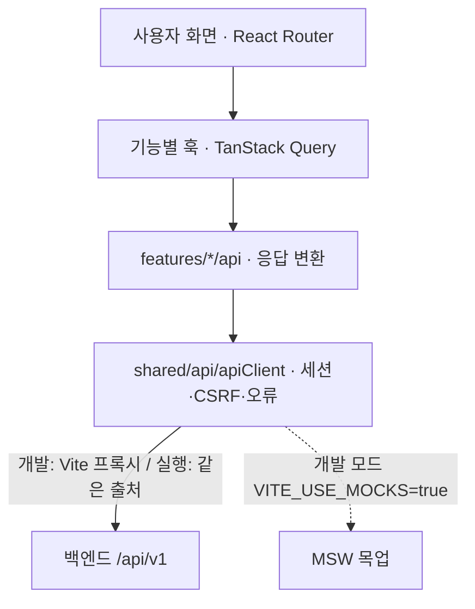
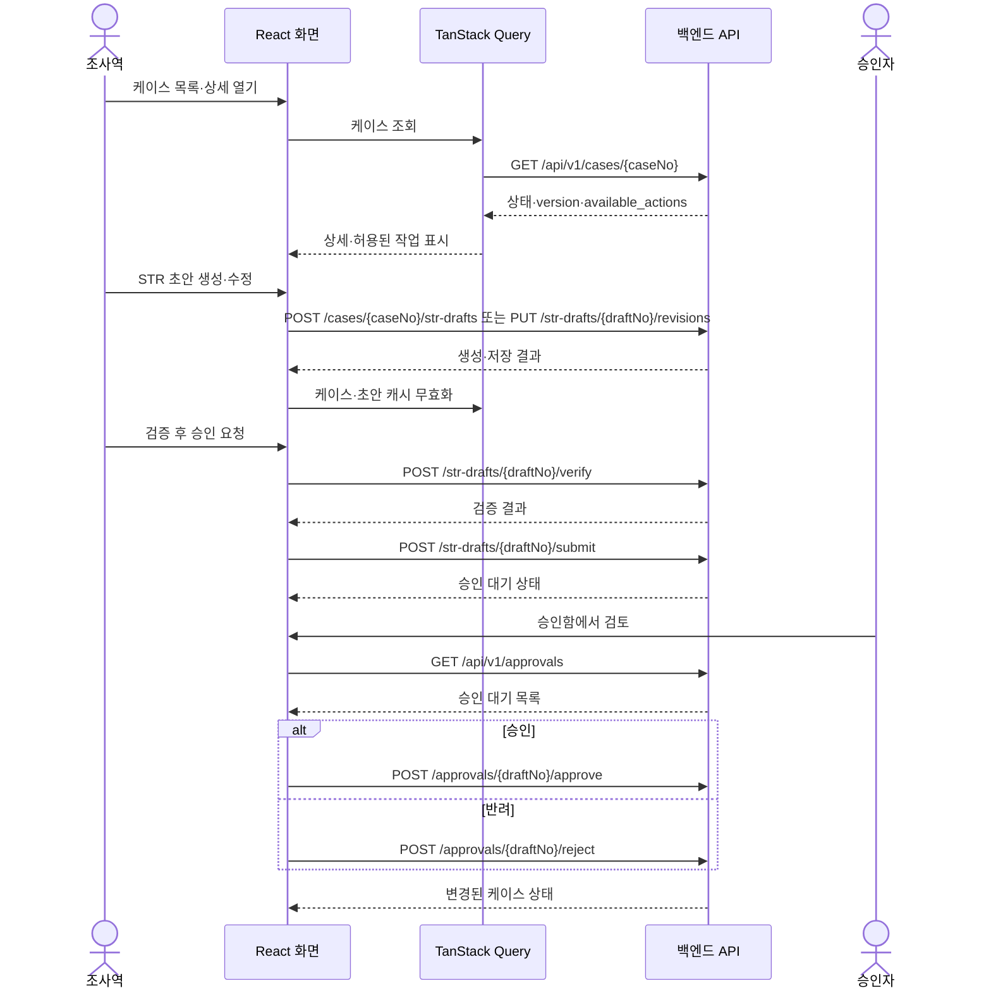
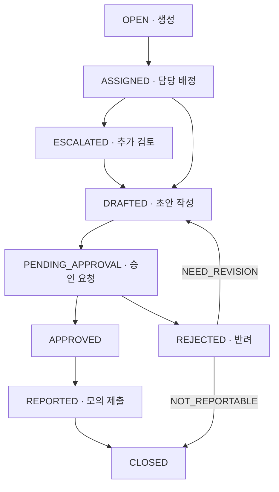
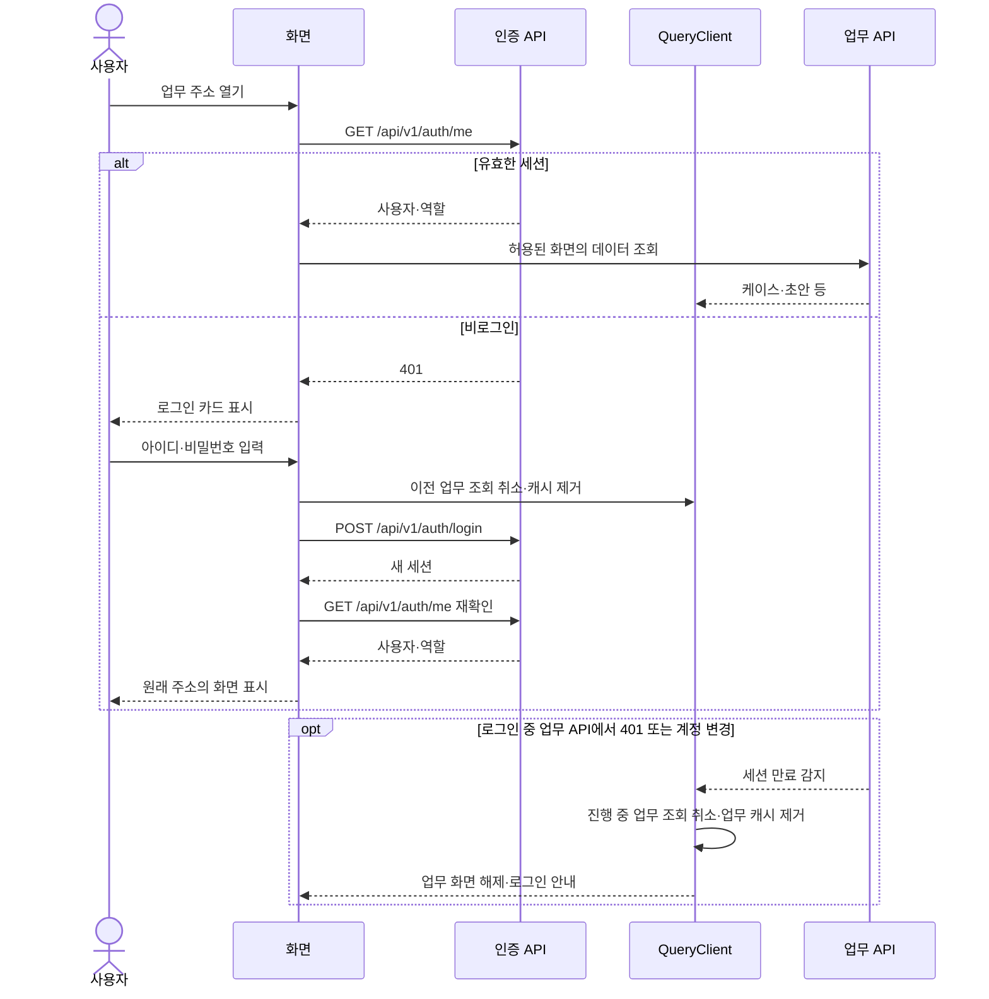
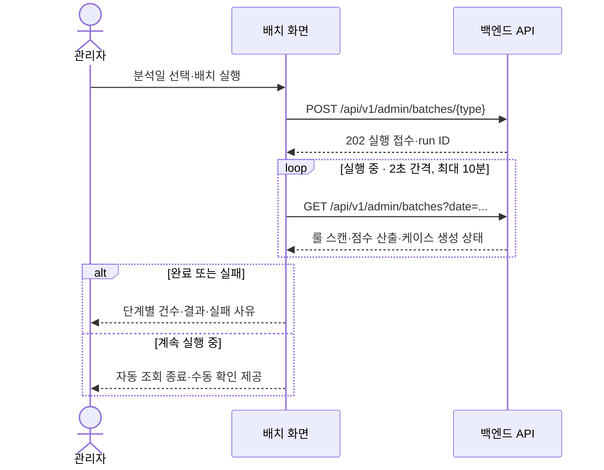

# dajaba frontend

<p align="center">
  
</p>

<p align="center"><strong>의심거래 탐지부터 STR 초안 검증·승인까지 이어지는 AML 조사 업무 화면</strong></p>

조사역은 경보에서 생성된 케이스의 거래·점수·이력을 확인하고, AI 조사 요약과 STR 초안을 검토합니다. 승인자는 제출된 초안을 승인하거나 반려하고, 관리자는 배치·계정·감사 기록을 확인합니다. 탐지와 판정, 권한과 상태 전이는 서버가 담당합니다.

**기술:** React 19 · JavaScript · Vite · React Router · TanStack Query · axios · MSW · Vitest

### 이 문서에서 볼 내용

- [화면과 역할](#화면-둘러보기): 누가 어떤 화면에서 무엇을 하는지
- [프론트 구조](#프론트-구조): 라우트에서 API까지 데이터가 흐르는 방식
- [업무 흐름](#조사에서-승인까지): 케이스·STR·승인 시퀀스
- [구현 상세](#핵심-구현): 세션, 충돌, 검증, 배치 진행 상태
- [실행과 검증](#로컬-실행): 목업·백엔드 연동·테스트

## 화면 둘러보기

| 화면          | 경로                                                | 주요 기능                                                            |
| ------------- | --------------------------------------------------- | -------------------------------------------------------------------- |
| 업무 대시보드 | `/overview`                                         | 역할별 업무 현황, 경보 등급 통계, 처리할 케이스·승인 건              |
| 조사 케이스   | `/cases`, `/cases/:caseNo`                          | 목록 필터·페이지, 담당 배정, 거래·흐름·근거·이력, 메모, AI 요약·질문 |
| STR 초안      | `/cases/:caseNo/str`                                | 초안 생성, 항목 수정·수정 이력, 검증, 승인 요청, 참고 사례 검색      |
| 승인함        | `/approvals`, `/approvals/:draftNo`                 | 승인·반려, 모의 제출, PDF 미리보기·확정본 확인                       |
| 관리자        | `/admin/batches`, `/admin/accounts`, `/admin/audit` | 데이터·탐지·케이스 생성 배치, 계정 관리, 감사 기록                   |

화면 진입은 `/overview`입니다. 관리자와 승인자 경로는 `RequireRole`로 보호하며, 케이스와 STR의 실행 버튼은 서버 응답의 `available_actions`를 따릅니다. `/admin/alerts`와 `/admin/rules`는 메뉴가 아직 열려 있지 않습니다.

### 역할별 사용 흐름

| 역할                  | 주요 진입 화면   | 이 화면에서 하는 일                                                          |
| --------------------- | ---------------- | ---------------------------------------------------------------------------- |
| 조사역 `INVESTIGATOR` | 케이스 목록      | 내 담당 케이스를 조사하고 메모·AI 요약·STR 초안을 검토한 뒤 승인 요청        |
| 승인자 `APPROVER`     | 승인함           | 제출된 초안의 본문과 변경 내역을 확인하고 승인 또는 사유를 적어 반려         |
| 관리자 `ADMIN`        | 데이터·배치 운영 | 배치 진행, 경보 통계, 계정 및 감사 기록을 확인하고 케이스·승인함 상태를 조회 |

역할별 첫 업무 메뉴는 `src/app/navigation/appNavigation.js`에서 정합니다. 기본 주소로 접속하면 `/overview`로 이동하고, 케이스 상세 등 특정 주소로 접속한 경우 로그인 뒤에도 그 주소를 유지합니다. 대시보드의 업무 시작 버튼은 해당 역할의 첫 화면으로 이동합니다. 프론트의 메뉴·라우트 가드는 사용성을 위한 첫 단계이며, 실제 권한과 케이스 상태는 각 API가 다시 검사합니다.

## 프론트 구조



`src/app/`은 라우팅·레이아웃·QueryClient, `src/features/`는 업무 기능, `src/shared/`는 공통 API·UI·상태 표시, `src/mocks/`는 개발용 응답을 담습니다. 서버의 `snake_case`를 화면의 `camelCase`로 바꾸는 곳은 기능별 API 파일입니다. 상세 구조와 규칙은 [`docs/02_structure.md`](docs/02_structure.md), [`docs/01_code_rules.md`](docs/01_code_rules.md)에 있습니다.

## 조사에서 승인까지



다이어그램의 `/cases`, `/str-drafts`, `/approvals` 쓰기 경로에도 모두 `/api/v1` 접두사가 붙습니다. 초안 생성·검증은 AI 응답을 기다리므로 별도 타임아웃을 쓰고, 저장·승인 요청은 자동 재시도하지 않습니다. 성공하거나 응답을 확인하지 못하면 관련 케이스·초안을 다시 조회합니다. 409 충돌에서는 사용자가 작성한 입력을 유지하고 최신 상태를 확인하도록 안내합니다. 서버는 승인 요청 때 현재 검증 결과와 권한을 다시 검사합니다.

### 케이스 상태와 화면의 다음 행동



이 그림은 주요 업무 화면에서 읽는 흐름을 요약한 것입니다. 실제 허용 전이와 종료 조건은 백엔드 상태 모델이 결정합니다. 화면은 반려 사유를 함께 표시해 보완 요청과 보고 대상 아님을 구분하고, 현재 응답에 없는 작업 버튼은 보여 주지 않습니다.

## 핵심 구현

### 1. 서버 데이터를 화면 상태와 분리

서버에서 받은 케이스·초안·승인 목록은 TanStack Query로 관리합니다. 조회 조건은 쿼리 키에 포함하고, 폼에 입력 중인 값과 열린 패널 같은 UI 상태만 컴포넌트에 둡니다. 예를 들어 케이스 목록의 상태·기간·담당자·정렬·페이지는 URL 쿼리에 저장됩니다. 상세에 들어갔다 돌아와도 같은 목록을 볼 수 있고, 주소를 공유하거나 새로고침해도 조회 조건이 유지됩니다.

| 데이터                | 위치                      | 이유                                 |
| --------------------- | ------------------------- | ------------------------------------ |
| 세션                  | `["auth", "me"]`          | 로그인 상태와 계정 전환의 기준       |
| 케이스 목록           | `["cases", filters]`      | 필터마다 다른 서버 결과 보관         |
| 케이스 상세·거래·이력 | `["case", caseNo, ...]`   | 케이스 변경 뒤 관련 조회를 함께 갱신 |
| STR 초안·수정본       | `["draft", draftNo, ...]` | 초안 저장·검증 뒤 최신 본문 조회     |
| 승인함                | `["approvals", page]`     | 승인·반려 뒤 처리된 행 제거          |
| 메모·STR 편집 중 입력 | 컴포넌트 상태             | 오류·재조회 중에도 작성 내용 유지    |

쓰기 요청은 자동 재시도하거나 화면을 먼저 성공 상태로 바꾸지 않습니다. 성공 응답을 받은 뒤 관련 쿼리를 무효화하고 서버의 최신 상태를 보여 줍니다. 응답이 끊겼을 때는 서버가 이미 처리했을 수도 있으므로 같은 쓰기를 바로 반복하지 않고 조회부터 다시 합니다.

### 2. 세션·권한과 계정 전환



`apiClient`는 세션 쿠키와 CSRF 헤더를 같은 출처 요청에 포함합니다. API에서 401이 발생하거나 `/auth/me`가 다른 사용자로 바뀌면 진행 중인 업무 조회를 취소하고 업무 쿼리·뮤테이션 캐시를 정리합니다. 로그인 실패 `LOGIN_FAILED`는 세션 만료와 구분합니다. 초안 API의 `access`가 `FULL`일 때만 본문을 화면 모델로 옮기고, `META_ONLY`에서는 상태·날짜만 표시합니다. 서버가 알 수 없는 접근 값을 보내도 본문을 열지 않습니다.

### 3. 케이스 조사와 동시 변경 대응

케이스 상세는 판단 요약 → AI 조사 요약과 점수 근거 → 거래 분석과 근거 → 조사 메모·처리 작업·케이스 정보 순서로 구성합니다. 거래 흐름 그래프, 거래 목록, 이력과 메모 이력은 각각 필요한 시점에 조회합니다. 근거 질의 패널에서는 답변의 근거 거래를 선택해 해당 거래 영역으로 이동할 수 있습니다.

케이스 변경 요청은 서버가 준 `version`을 함께 보내 낙관적 락 충돌을 확인합니다. 다른 사용자가 먼저 변경해 409 `CONCURRENT_UPDATE`가 오면 최신 상세·목록을 다시 불러오고, 메모나 편집 중인 문장은 유지합니다. 현재 상태에서 허용되지 않는 전이(`INVALID_CASE_TRANSITION`)나 담당자 변경(`NOT_ASSIGNEE`)도 최신 `available_actions`를 다시 확인합니다.

| 상황               | 화면 처리                                                         |
| ------------------ | ----------------------------------------------------------------- |
| 저장 성공          | 케이스 상세와 목록을 다시 조회하고 저장 결과 표시                 |
| 409 동시 변경      | 작성 내용 유지, 최신 상태 재조회 후 비교·재시도 안내              |
| 응답 없음·타임아웃 | 서버 처리 여부가 불명확하므로 최신 상태 조회                      |
| 세션 만료          | 업무 화면과 캐시를 비우고 로그인 안내                             |
| 권한 없음          | 서버 오류 코드를 사용자 문구로 바꾸고 작업을 완료로 표시하지 않음 |

### 4. STR 초안·검증·승인

STR 화면은 먼저 케이스 상세의 `current_draft_no`를 확인하고, 값이 있으면 해당 초안을 조회합니다. 초안은 `facts`와 본문 `narrative`를 나누어 보여 줍니다. 수정할 때는 바뀐 섹션의 `section`·`text`만 전송하며, 원본 사실·인용 근거는 화면에서 임의로 다시 쓰지 않습니다. 수정 이력과 변경 비교로 어떤 내용이 바뀌었는지 볼 수 있습니다.

검증은 현재 **저장된 수정본**에 대해 실행합니다. 미저장 입력이 있으면 검증을 막고 저장을 안내합니다. 검증 결과의 통과 여부와 현재 수정본 일치 여부를 확인한 뒤 의심 유형·지점 의심 정도를 입력해 승인 요청합니다. 반려 후에는 `NEED_REVISION`과 `NOT_REPORTABLE`을 구분해 다음 작업을 안내하며, 같은 본문을 그대로 재제출할 수 없는 경우 서버의 `NARRATIVE_UNCHANGED`를 설명합니다. 승인자는 승인함에서 목록을 보고 초안 화면으로 이동해 본문·변경 내역을 읽은 뒤 결정합니다.

AI를 기다리는 초안 생성·검증·요약 갱신은 요청 타임아웃을 100초로, 근거 질문은 35초로 설정했습니다. 일반 API는 15초입니다. 이 값은 프론트의 대기 한도이며 AI 작업의 성공을 보장하는 수치는 아닙니다.

### 5. 관리자 배치의 진행 상태



관리자는 분석일을 선택해 원천 적재와 배치 실행을 시작합니다. 서버가 제공하는 실행 기록을 바탕으로 룰 스캔·점수 산출·케이스 생성의 상태와 처리 건수를 보여 줍니다. 실행 중인 단계는 2초 간격으로 다시 읽고, 시작 후 10분이 지나면 자동 조회만 멈춥니다. 방금 완료된 단계는 다음 단계가 시작될 시간을 고려해 잠시 더 확인합니다. 오래 실행 중이라고 실패로 단정하지 않고 사용자가 수동으로 상태를 다시 확인할 수 있습니다. 선택한 분석일은 사용자별로 브라우저 탭에 기억하며, 새로고침 뒤에도 해당 날짜의 서버 실행 기록을 다시 불러옵니다.

## API 연결 지점

모든 API 경로는 `/api/v1` 기준입니다. 아래 표는 화면에서 호출하는 대표 요청만 추렸습니다. 전체 필드·오류 계약은 [`docs/03_api.md`](docs/03_api.md)와 기능별 API 파일을 확인해 주세요.

| 기능    | 대표 요청                                                                                                                                          | 프론트에서 주의하는 값                                     |
| ------- | -------------------------------------------------------------------------------------------------------------------------------------------------- | ---------------------------------------------------------- |
| 인증    | `GET /auth/me`, `POST /auth/login`, `POST /auth/logout`                                                                                            | 세션 쿠키·CSRF, 401 구분                                   |
| 케이스  | `GET /cases`, `GET /cases/{caseNo}`, `PUT /cases/{caseNo}/notes`                                                                                   | `available_actions`, `version`, 0부터 시작하는 서버 페이지 |
| AI 조사 | `POST /cases/{caseNo}/refresh-summary`, `POST /cases/{caseNo}/questions`                                                                           | 긴 대기 시간, 응답 없음 뒤 조회                            |
| STR     | `POST /cases/{caseNo}/str-drafts`, `PUT /str-drafts/{draftNo}/revisions`, `POST /str-drafts/{draftNo}/verify`, `POST /str-drafts/{draftNo}/submit` | 수정본·검증 결과의 현재성, `access`                        |
| 승인    | `GET /approvals`, `POST /approvals/{draftNo}/approve`, `POST /approvals/{draftNo}/reject`                                                          | 자기 승인 제한, 처리 뒤 목록·초안 갱신                     |
| 관리자  | `GET /admin/batches`, `GET /admin/alerts/stats`, `GET /admin/access-logs`                                                                          | 실행 상태 폴링, 역할 제한                                  |

서버의 목록 페이지는 0부터, 화면의 페이지는 1부터 셉니다. 이 차이와 `snake_case` 변환은 각 `features/*/api`에서 처리해 페이지 컴포넌트에 퍼지지 않게 했습니다. API의 오류 응답은 `error.code`를 기준으로 안내 문구를 정합니다.

## 로컬 실행

Node 버전은 `.nvmrc`의 **22.22.0**입니다.

```bash
git clone https://github.com/dajaba-team/dajaba-frontend.git
cd dajaba-frontend
nvm install && nvm use
npm ci
cp .env.example .env.local
npm run dev
```

`http://localhost:5173`에서 실행합니다. 백엔드와 연결할 때는 `.env.local`의 `VITE_USE_MOCKS=false`를 사용하고 백엔드를 8080 포트로 실행합니다. Vite가 개발 중 `/api`를 백엔드로 전달합니다. `/dev/connection`에서 서버·세션·CSRF 연동을 확인할 수 있습니다.

백엔드 없이 화면을 확인하려면 `.env.local`에 `VITE_USE_MOCKS=true`를 지정하고 개발 서버를 다시 시작합니다. 예시 조사역 계정은 `inv01` / `mock-password`입니다. MSW 데이터는 새로고침하면 초기화됩니다. `/demo/*`도 개발 모드 전용 합성 데이터 화면이며 운영 빌드에서는 제외됩니다.

| 환경 변수           | 용도                                   |
| ------------------- | -------------------------------------- |
| `VITE_API_BASE_URL` | API 기본 주소. 비우면 같은 출처를 사용 |
| `VITE_USE_MOCKS`    | 개발 모드에서 `true`일 때 MSW 사용     |

`VITE_` 환경 변수는 빌드에 포함되므로 비밀번호나 비밀키를 넣지 않습니다.

## 개발·검증

```bash
npm run lint
npm run format:check
npm run test:run
npm run build
```

CI에서도 위 네 명령을 실행합니다. 사용자 흐름 테스트는 Vitest · Testing Library · MSW를 사용합니다. 세션 만료·계정 전환 때는 진행 중 조회를 취소하고 업무 캐시를 지워 이전 사용자의 데이터가 남지 않도록 합니다. 상세·초안 열람처럼 서버에 접근 기록이 남는 조회는 창 포커스 복귀만으로 다시 호출하지 않습니다.

API·화면별 상세는 [`docs/README.md`](docs/README.md)에서, 서버 설계와 상태 전이 기준은 [백엔드 저장소](https://github.com/dajaba-team/dajaba-backend)에서 확인할 수 있습니다. 팀 작업은 `feat/SCRUM-xx` 브랜치에서 `develop` 대상 PR로 진행합니다.
