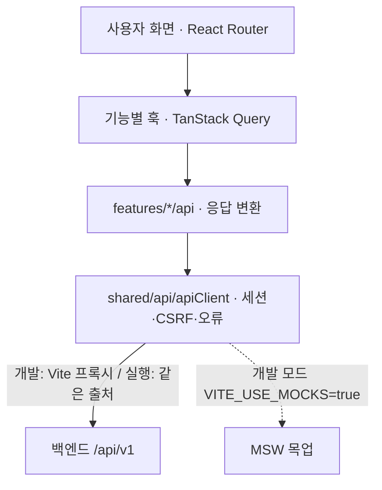
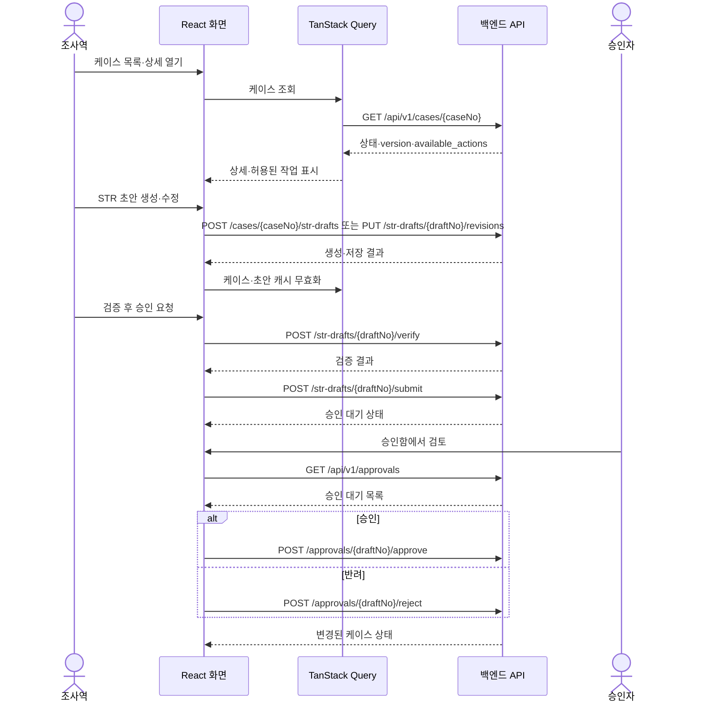

# dajaba frontend

<p align="center">
  
</p>

<p align="center"><strong>의심거래 탐지부터 STR 초안 검증·승인까지 이어지는 AML 조사 업무 화면</strong></p>

조사역은 경보에서 생성된 케이스의 거래·점수·이력을 확인하고, AI 조사 요약과 STR 초안을 검토합니다. 승인자는 제출된 초안을 승인하거나 반려하고, 관리자는 배치·계정·감사 기록을 확인합니다. 탐지와 판정, 권한과 상태 전이는 서버가 담당합니다.

**기술:** React 19 · JavaScript · Vite · React Router · TanStack Query · axios · MSW · Vitest

## 화면 둘러보기

| 화면          | 경로                                                | 주요 기능                                                            |
| ------------- | --------------------------------------------------- | -------------------------------------------------------------------- |
| 업무 대시보드 | `/overview`                                         | 역할별 업무 현황, 경보 등급 통계, 처리할 케이스·승인 건              |
| 조사 케이스   | `/cases`, `/cases/:caseNo`                          | 목록 필터·페이지, 담당 배정, 거래·흐름·근거·이력, 메모, AI 요약·질문 |
| STR 초안      | `/cases/:caseNo/str`                                | 초안 생성, 항목 수정·수정 이력, 검증, 승인 요청, 참고 사례 검색      |
| 승인함        | `/approvals`, `/approvals/:draftNo`                 | 승인·반려, 모의 제출, PDF 미리보기·확정본 확인                       |
| 관리자        | `/admin/batches`, `/admin/accounts`, `/admin/audit` | 데이터·탐지·케이스 생성 배치, 계정 관리, 감사 기록                   |

화면 진입은 `/overview`입니다. 관리자와 승인자 경로는 `RequireRole`로 보호하며, 케이스와 STR의 실행 버튼은 서버 응답의 `available_actions`를 따릅니다. `/admin/alerts`와 `/admin/rules`는 메뉴가 아직 열려 있지 않습니다.

## 프론트 구조



`src/app/`은 라우팅·레이아웃·QueryClient, `src/features/`는 업무 기능, `src/shared/`는 공통 API·UI·상태 표시, `src/mocks/`는 개발용 응답을 담습니다. 서버의 `snake_case`를 화면의 `camelCase`로 바꾸는 곳은 기능별 API 파일입니다. 상세 구조와 규칙은 [`docs/02_structure.md`](docs/02_structure.md), [`docs/01_code_rules.md`](docs/01_code_rules.md)에 있습니다.

## 조사에서 승인까지



다이어그램의 `/cases`, `/str-drafts`, `/approvals` 쓰기 경로에도 모두 `/api/v1` 접두사가 붙습니다. 초안 생성·검증은 AI 응답을 기다리므로 별도 타임아웃을 쓰고, 저장·승인 요청은 자동 재시도하지 않습니다. 성공하거나 응답을 확인하지 못하면 관련 케이스·초안을 다시 조회합니다. 409 충돌에서는 사용자가 작성한 입력을 유지하고 최신 상태를 확인하도록 안내합니다. 서버는 승인 요청 때 현재 검증 결과와 권한을 다시 검사합니다.

## 로컬 실행

Node 버전은 `.nvmrc`의 **22.22.0**입니다.

```bash
git clone https://github.com/dajaba-team/dajaba-frontend.git
cd dajaba-frontend
nvm install && nvm use
npm ci
cp .env.example .env.local
npm run dev
```

`http://localhost:5173`에서 실행합니다. 백엔드와 연결할 때는 `.env.local`의 `VITE_USE_MOCKS=false`를 사용하고 백엔드를 8080 포트로 실행합니다. Vite가 개발 중 `/api`를 백엔드로 전달합니다. `/dev/connection`에서 서버·세션·CSRF 연동을 확인할 수 있습니다.

백엔드 없이 화면을 확인하려면 `.env.local`에 `VITE_USE_MOCKS=true`를 지정하고 개발 서버를 다시 시작합니다. 예시 조사역 계정은 `inv01` / `mock-password`입니다. MSW 데이터는 새로고침하면 초기화됩니다. `/demo/*`도 개발 모드 전용 합성 데이터 화면이며 운영 빌드에서는 제외됩니다.

| 환경 변수           | 용도                                   |
| ------------------- | -------------------------------------- |
| `VITE_API_BASE_URL` | API 기본 주소. 비우면 같은 출처를 사용 |
| `VITE_USE_MOCKS`    | 개발 모드에서 `true`일 때 MSW 사용     |

`VITE_` 환경 변수는 빌드에 포함되므로 비밀번호나 비밀키를 넣지 않습니다.

## 개발·검증

```bash
npm run lint
npm run format:check
npm run test:run
npm run build
```

CI에서도 위 네 명령을 실행합니다. 사용자 흐름 테스트는 Vitest · Testing Library · MSW를 사용합니다. 세션 만료·계정 전환 때는 진행 중 조회를 취소하고 업무 캐시를 지워 이전 사용자의 데이터가 남지 않도록 합니다. 상세·초안 열람처럼 서버에 접근 기록이 남는 조회는 창 포커스 복귀만으로 다시 호출하지 않습니다.

API·화면별 상세는 [`docs/README.md`](docs/README.md)에서, 서버 설계와 상태 전이 기준은 [백엔드 저장소](https://github.com/dajaba-team/dajaba-backend)에서 확인할 수 있습니다. 팀 작업은 `feat/SCRUM-xx` 브랜치에서 `develop` 대상 PR로 진행합니다.
