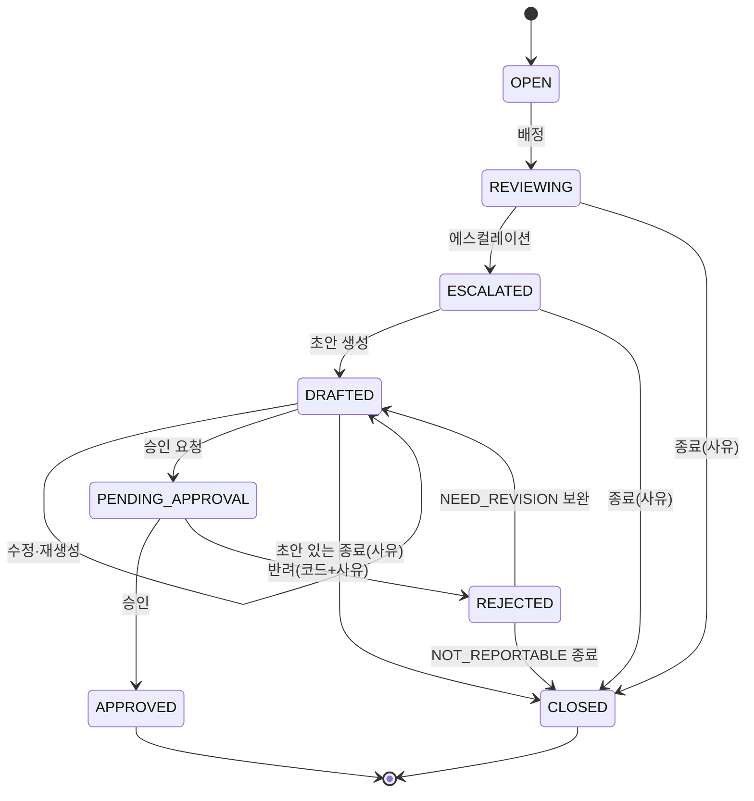

# 06. 기능별 정리

> v0.1 · 2026-10-31 · 초안(팀 확인 중) · 정리 지윤

화면마다 **경로 · 보이는 것 · 상태별 버튼 · 쓰는 API · 실패 처리 · 지금 상태**를 모았어요. 각자 자기 파일만 고치면 되도록 기능별로 나눴어요. 백엔드 `docs/06_features/`와 짝이에요.

| 파일                           | 화면                                                                         | 프론트 폴더                         | 백엔드 짝                                | 담당          |
| ------------------------------ | ---------------------------------------------------------------------------- | ----------------------------------- | ---------------------------------------- | ------------- |
| [`cases.md`](cases.md)         | 케이스 목록 · 상세 · 근거 거래 · 메모 · AI 요약 · 배정 · 에스컬레이션 · 종료 | `features/cases`                    | `cases` (지윤)                           | 〔확인 필요〕 |
| [`str.md`](str.md)             | STR 초안 생성 · 섹션 수정 · 검증 · 승인 요청 · 재생성                        | `features/str`                      | `str` (채영)                             | 〔확인 필요〕 |
| [`approvals.md`](approvals.md) | 승인함 · 승인 · 반려 · 모의 제출                                             | `features/approvals`                | `str` 승인 API (채영)                    | 〔확인 필요〕 |
| [`admin.md`](admin.md)         | 데이터·배치 운영 · 경보 점검 · 탐지 룰 · 계정 관리 · 로그                    | `features/admin`, `alerts`, `rules` | `source`·`detection`(준혁), `user`(진희) | 〔확인 필요〕 |

로그인·세션·역할은 [`../04_auth_session.md`](../04_auth_session.md)에 있어요. 업무 개요·평가·감사 기록 화면은 지금 `/demo`에만 있고 백엔드 API가 정해지면 파일을 추가해요.

## 케이스 상태 한 장 [BE 코드 `CaseStatus`·`RejectionReasonCode`]

모든 화면이 같이 보는 상태 8개예요. **전이 판단은 서버가 해요.** 프론트는 지금 상태를 보여 주고 버튼만 고르면 돼요.

| 상태               | 화면 글자 〔제안〕                       | 끝 상태 |
| ------------------ | ---------------------------------------- | ------- |
| `OPEN`             | 배정 대기                                |         |
| `REVIEWING`        | 조사 중                                  |         |
| `ESCALATED`        | 보고 검토(상신)                          |         |
| `DRAFTED`          | 초안 작성 중                             |         |
| `PENDING_APPROVAL` | 승인 대기                                |         |
| `APPROVED`         | 내부 승인 완료 (기관 제출 아님)          | ○       |
| `REJECTED`         | 반려 — 반려 코드에 따라 다음 행동이 갈림 |         |
| `CLOSED`           | 종결 (범죄 없음 확정이 아님)             | ○       |

- `PENDING_APPROVAL → CLOSED`는 없어요(안건 24). 승인 대기 중엔 조사역 화면이 읽기 전용.
- 종결 사유 `close_reason`: `FALSE_POSITIVE`(오탐) · `DUPLICATE`(중복 경보) · `NO_ACTION`(추가 조치 불필요) + 코멘트. [BE 코드 `CloseReason`]
- STR 초안 상태는 따로 3개: `ACTIVE`(수정·검증 가능) · `SUPERSEDED`(재생성·종결로 대체) · `LOCKED`(승인됨). [BE 코드 `StrDraftStatus`]
- 그림 전체는 BE flows 06 「화면과 상태의 대응」 표가 정본이에요.
