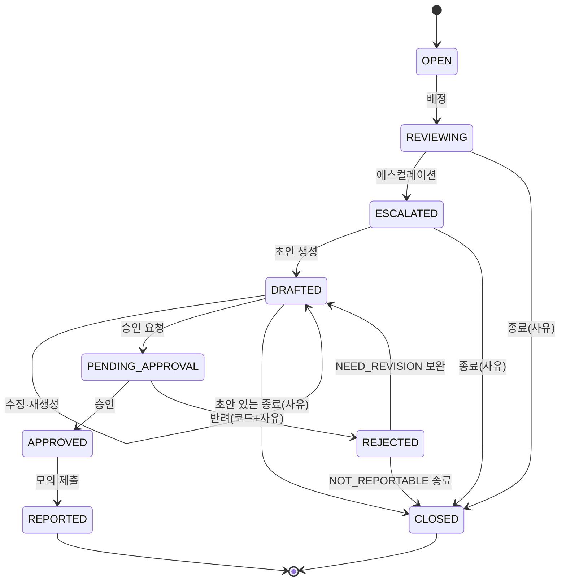

# 06. 기능별 정리

> v0.2 · 2026-11-08 · 초안(팀 확인 중) · 정리 지윤 · 11/8 상태 9개(SCRUM-172)

화면마다 **경로 · 보이는 것 · 상태별 버튼 · 쓰는 API · 실패 처리 · 지금 상태**를 모았어요. 각자 자기 파일만 고치면 되도록 기능별로 나눴어요. 백엔드 `docs/06_features/`와 짝이에요.

| 파일                           | 화면                                                                         | 프론트 폴더                         | 백엔드 짝                                | 담당                                                       |
| ------------------------------ | ---------------------------------------------------------------------------- | ----------------------------------- | ---------------------------------------- | ---------------------------------------------------------- |
| [`cases.md`](cases.md)         | 케이스 목록 · 상세 · 근거 거래 · 메모 · AI 요약 · 배정 · 에스컬레이션 · 종료 | `features/cases`                    | `cases` (지윤)                           | 지윤 [11/7]                                                |
| [`str.md`](str.md)             | STR 초안 생성 · 섹션 수정 · 검증 · 승인 요청 · 재생성                        | `features/str`                      | `str` (채영)                             | 채영 [11/7]                                                |
| [`approvals.md`](approvals.md) | 승인함 · 승인 · 반려 · 모의 제출                                             | `features/approvals`                | `str` 승인 API (채영)                    | 채영 [11/7]                                                |
| [`admin.md`](admin.md)         | 데이터·배치 운영 · 경보 점검 · 탐지 룰 · 계정 관리 · 감사 기록               | `features/admin`, `alerts`, `rules` | `source`·`detection`(준혁), `user`(진희) | 준혁(배치·경보·탐지 룰) · 진희(계정 관리·감사 기록) [11/7] |

로그인·세션·역할은 [`../04_auth_session.md`](../04_auth_session.md)에 있어요. 업무 개요·평가·감사 기록 화면은 지금 `/demo`에만 있고 백엔드 API가 정해지면 파일을 추가해요.

## 새 화면 붙이는 법 [SCRUM-159 ②, 11/7]

공통 틀(메뉴·안내 띠·알림·확인창·`RequireRole`)이 깔려 있어요. 새 화면은 아래 다섯 줄만.

1. 페이지 컴포넌트 — `src/features/{기능}/pages/{Name}Page.jsx`. 데이터는 `features/{기능}/api/`와 `useQuery`로.
2. 라우트 — `src/app/router.jsx`에 한 줄. 역할 제한은 `<Route element={<RequireRole roles={["ADMIN"]} />}>` 안에.
3. 메뉴 켜기 — `src/app/navigation/appNavigation.js`의 내 메뉴 줄 `ready: false` → `ready: true`. 자리에 없으면 한 줄 추가(`id`·`path`·`label`·`roles`).
4. 안내 띠 문구 — 페이지 안에서 `useGuide("이 화면에서 할 일 한 줄")`. 화면을 떠나면 역할 기본 문구로 돌아가요. 상태별 문구는 그 기능 폴더에 두고(`features/cases/guide.js` 같은 곳) 상세 화면에서 `useGuide(guideForCase(status))`로.
5. 결과 알림·확인창 — `const { show } = useToast()`로 "저장했어요"/"저장 실패"를 띄우고, 되돌릴 수 없는 버튼은 `ConfirmDialog`(제목·본문·[취소]·[확인]). 사유 입력이 있는 확인창은 `shared/ui/dashboard/Modal`을 직접 써요.

버튼은 서버 응답의 `available_actions`만 보고 켜요 — 역할·담당·상태로 화면이 계산하지 않아요. → `../01_code_rules.md` §1, `../04_auth_session.md` §4.

## 케이스 상태 한 장 [BE 코드 `CaseStatus`·`RejectionReasonCode`]

모든 화면이 같이 보는 상태 9개예요. **전이 판단은 서버가 해요.** 프론트는 지금 상태를 보여 주고 버튼만 고르면 돼요.

| 상태               | 화면 글자 〔제안〕                       | 끝 상태 |
| ------------------ | ---------------------------------------- | ------- |
| `OPEN`             | 배정 대기                                |         |
| `REVIEWING`        | 조사 중                                  |         |
| `ESCALATED`        | 에스컬레이션됨 (보고 검토)               |         |
| `DRAFTED`          | 초안 작성 중                             |         |
| `PENDING_APPROVAL` | 승인 대기                                |         |
| `APPROVED`         | 내부 승인 완료 (기관 제출 아님)          |         |
| `REPORTED`         | 보고됨 (모의 제출, 실제 기관 전송 없음)  | ○       |
| `REJECTED`         | 반려 — 반려 코드에 따라 다음 행동이 갈림 |         |
| `CLOSED`           | 종결 (범죄 없음 확정이 아님)             | ○       |

- `PENDING_APPROVAL → CLOSED`는 없어요(안건 24). 승인 대기 중엔 조사역 화면이 읽기 전용.
- `APPROVED → REPORTED`는 승인자의 모의 제출(`POST /approvals/{draft_no}/report`, 〔초안〕)이에요. 끝 상태는 `REPORTED`·`CLOSED` 둘 [CASES 명세 v0.7, BE `CaseStatus`·V006 CHECK].
- 종결 사유 `close_reason`: `FALSE_POSITIVE`(오탐) · `DUPLICATE`(중복 경보) · `NO_ACTION`(추가 조치 불필요) + 코멘트. [BE 코드 `CloseReason`]
- STR 초안 상태는 따로 3개: `ACTIVE`(수정·검증 가능) · `SUPERSEDED`(재생성·종결로 대체) · `LOCKED`(승인됨). [BE 코드 `StrDraftStatus`]
- 그림 전체는 BE flows 06 「화면과 상태의 대응」 표가 정본이에요.
